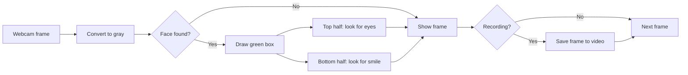

# 🎥 Smart Face Detector

A real-time **face, eye and smile detector** built with Python and OpenCV. It reads your webcam, draws a box around each face, tells you when it sees eyes or a smile, and can **record the video** with one key press.


<p align="center">
  
</p>

---

## ✨ Features

- 🟩 Face detection with a green box
- 👁️ Eye detection (searched only in the top half of the face)
- 😄 Smile detection (searched only in the bottom half of the face)
- 🔴 Video recorder: press `r` to start and stop
- 📁 Recordings are saved with the date and time in the file name

---

## 🧠 How it works

Think of the webcam as a **microscope** and the detector as a **lab student** looking for cells. The student does not look at the whole slide for everything. First they find the cell, then they zoom in to look for parts inside it.



### Where do `x, y, w, h` come from?

You do **not** choose them. `detectMultiScale` finds the face and gives you the numbers. Watch the animation:

<p align="center">
  
</p>

- `x` = how far from the **left** edge
- `y` = how far from the **top** edge
- `w` = width of the face box
- `h` = height of the face box

Images are stored as `[rows, columns]`, which means **`[y, x]`**, not `[x, y]`. That is why the crop is written as `gray[y : y+h, x : x+w]`.

### Step-by-step trace of one frame

Say the detector returns one face: `x=210, y=90, w=120, h=120`.

1. `cap.read()` gives one colour frame (blue, green, red channels).
2. `cvtColor(..., COLOR_BGR2GRAY)` makes a gray copy. Gray is faster to search.
3. `detectMultiScale` returns `[(210, 90, 120, 120)]`.
4. A green rectangle is drawn from `(210, 90)` to `(330, 210)`.
5. Eye search runs on `gray[90:150, 210:330]` (top half: `h // 2 = 60` rows).
6. Smile search runs on `gray[150:210, 210:330]` (bottom half).
7. Text is drawn, the frame is shown, and if recording, it is written to the file.

---

## ⚙️ Settings you can tune

| Setting | Meaning | Biology analogy |
|---|---|---|
| `scaleFactor=1.1` | How much the search window grows each pass. Smaller = slower but finds more. | Changing the microscope zoom in small steps |
| `minNeighbors=5` | How many nearby boxes must agree before it counts as a face. 3 = loose, 5 = safe, 6+ = strict. | A cell is counted only if several slides agree |
| Smile `20` | Higher = fewer false smiles. Lower = more sensitive. | How strict the stain threshold is |

---

## 🚀 Setup and run

### Option A: with [uv](https://docs.astral.sh/uv/) (recommended)

```bash
git clone https://github.com/vighneshgaikwad59-web/smart-face-detector.git
cd smart-face-detector
uv venv
uv pip install -r requirements.txt
uv run app.py
```

### Option B: with pip

```bash
git clone https://github.com/vighneshgaikwad59-web/smart-face-detector.git
cd smart-face-detector
python -m venv .venv
.venv\Scripts\activate        # Windows
# source .venv/bin/activate   # macOS / Linux
pip install -r requirements.txt
python app.py
```

---

## 🎮 Controls

| Key | Action |
|---|---|
| `r` | Start or stop recording |
| `q` | Quit (a running recording is saved first) |

Videos are saved in the `recordings/` folder.

---

## 📂 Project structure

```
smart-face-detector/
├── app.py              # main program
├── assets/
│   ├── pipeline.svg    # animation: how a frame is processed
│   └── bbox.svg        # animation: x, y, w, h
├── requirements.txt
├── .gitignore
├── LICENSE
└── README.md
```

The Haar cascade XML files come with OpenCV (`cv2.data.haarcascades`), so you do not need to download them.

---

## 🛠️ Troubleshooting

| Error | Cause | Fix |
|---|---|---|
| `module 'cv2' has no attribute 'CascadeClassifier'` | A broken install, or a file or folder named `cv2` in your project | Rename any `cv2.py`/`cv2` folder, then `uv pip uninstall opencv-python opencv-contrib-python opencv-python-headless` and reinstall `opencv-python` |
| Works with `uv run` but not with the Run button | Plain `python` is not using the `.venv` | In VS Code: `Ctrl+Shift+P` → **Python: Select Interpreter** → choose `.venv` |
| `SyntaxError: (unicode error) 'unicodeescape'...` | `\U` in a Windows path inside a normal string | Use `r"C:\path"`, forward slashes, or `cv2.data.haarcascades` |
| `cv2.error ... demosaicing` | Wrong colour code `COLOR_BAYER_BG2GRAY` | Use `cv2.COLOR_BGR2GRAY` |
| Empty or zero-size video | Frame size mismatch or codec problem | Use the webcam's real width and height, or try `XVID` with an `.avi` file |

---

## ⚠️ Limitations

Haar cascades are an older method. They work best with good light and a face looking straight at the camera. Smile detection can be unstable.

## 🔮 Ideas for next steps

- [ ] Use a deep-learning face detector (for example OpenCV DNN or MediaPipe)
- [ ] Record only when a face is found
- [ ] Take a snapshot with a key press
- [ ] Count faces on screen

---

## 👤 Author

**Vighnesh Anand Gaikwad**: [@vighneshgaikwad59-web](https://github.com/vighneshgaikwad59-web)

Licensed under the [MIT License](LICENSE).
